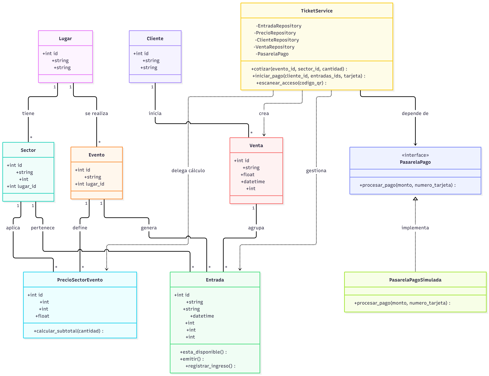
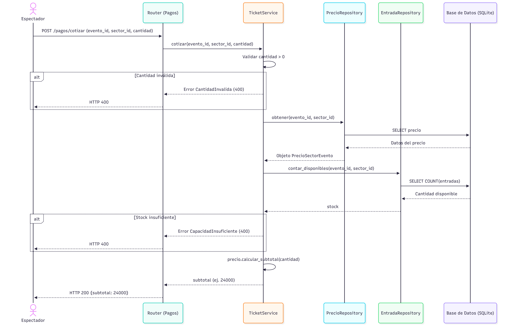
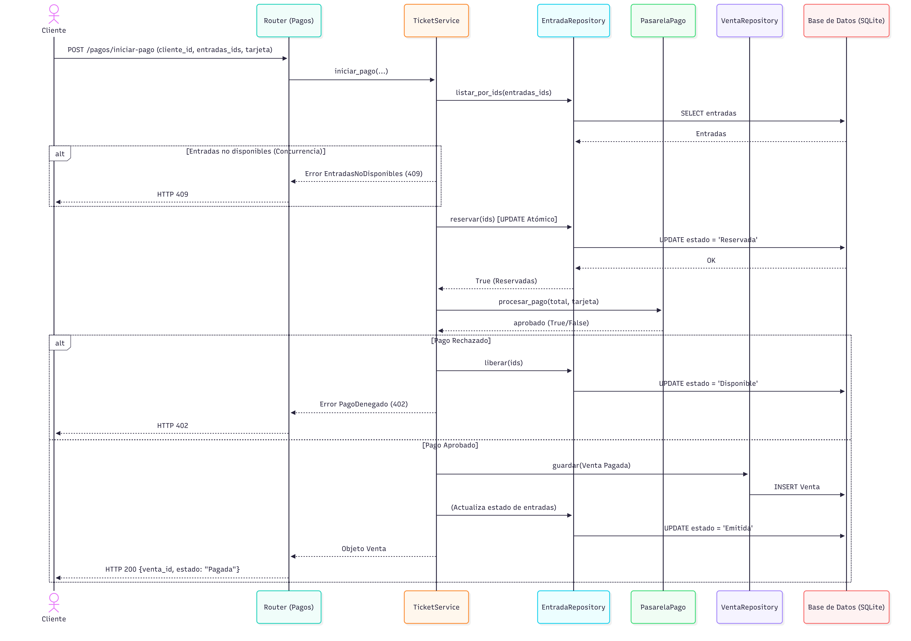

# TP 9 - POO — SmartTicket
**Grupo 13**

**Integrantes:** Milton Cárdenas, Hilt Malena, Lavergne Elizabeth, Molina Guadalupe, Roude Mariel, Tejeda Lucía. 

API para gestión de entradas, pagos y control de acceso a eventos, desarrollada con **FastAPI**, **SQLAlchemy** y **SQLite**.

## Tecnologías

Python 3.13 · FastAPI · Uvicorn · SQLAlchemy · SQLite · Pydantic

```text
poo_tp9/
├── app/
│   ├── main.py              # App FastAPI, creación de tablas y manejo de errores
│   ├── database.py          # Conexión SQLite y sesiones
│   ├── models.py            # Entidades (Lugar, Sector, Evento, PrecioSectorEvento, Entrada, Cliente, Venta)
│   ├── schemas.py           # Esquemas Pydantic
│   ├── repositories.py      # Acceso a datos (incluye operaciones CRUD)
│   ├── routers/
│   │   ├── pagos.py         # Endpoints de las Historias de Usuario
│   │   └── crud.py          # Endpoints de Administración (ABM básico)
│   └── services/
│       ├── ticket_service.py # Lógica de negocio
│       ├── pasarela_pago.py  # PasarelaPago (abstracta) y PasarelaPagoSimulada
│       └── excepciones.py    # Errores de dominio con su código HTTP
├── diagramas/               # Diagramas UML exportados
│   ├── diagrama-clases.png
│   ├── secuencia-hu1.png
│   ├── secuencia-hu2.png
│   └── secuencia-hu3.png
├── seed.py                  # Datos de prueba
├── requirements.txt
└── README.md
```


## Instalación y ejecución

```powershell
git clone https://github.com/guadalupemolinna/poo_tp9.git
cd poo_tp9
py -3.13 -m venv .venv
.\.venv\Scripts\Activate.ps1
python -m pip install -r requirements.txt
python seed.py
python -m uvicorn app.main:app --reload
```

Si PowerShell bloquea la activación: `Set-ExecutionPolicy -Scope Process -ExecutionPolicy RemoteSigned`.

- API: http://127.0.0.1:8000
- Swagger: http://127.0.0.1:8000/docs

## Base de datos

`seed.py` crea las tablas y carga los datos de prueba en `database.db` (no se sube al repositorio). Para regenerarla: detener el servidor, borrar `database.db` y volver a ejecutar `python seed.py`.

> No ejecutar `seed.py` dos veces sobre la misma base: duplica los datos.

### Datos de prueba

| Entidad | Datos |
|---|---|
| Evento | ID 1 — Rock Fest |
| Sector | ID 1 — Platea, capacidad 10, precio $12000 |
| Cliente | ID 1 — Juan Pérez (juan@email.com) |
| Entradas | IDs 1 a 10, QR `QR-ROCKFEST-PLATEA-001` a `QR-ROCKFEST-PLATEA-010` |


### Endpoints

### Administración / CRUD

Permiten crear y listar las entidades base del sistema para probar el flujo vertical desde la base de datos hasta el controlador.

- `POST /admin/lugares` — Crear un Lugar.
- `GET /admin/lugares` — Listar Lugares.
- `GET /admin/lugares/{id}` — Buscar un Lugar por su ID.
- `POST /admin/sectores` — Crear un Sector.
- `GET /admin/sectores` — Listar Sectores.
- `GET /admin/sectores/{id}` — Buscar un Sector por su ID.
- `POST /admin/eventos` — Crear un Evento.
- `GET /admin/eventos` — Listar Eventos.
- `GET /admin/eventos/{id}` — Buscar un Evento por su ID.
- `POST /admin/clientes` — Crear un Cliente.
- `GET /admin/clientes` — Listar Clientes.
- `GET /admin/clientes/{id}` — Buscar un Cliente por su ID.
- `POST /admin/precios` — Asignar un Precio a un Sector/Evento.
- `GET /admin/precios` — Listar Precios.
- `GET /admin/precios/{id}` — Buscar un Precio por su ID.


### HU1 — `POST /pagos/cotizar`

```json
{ "evento_id": 1, "sector_id": 1, "cantidad": 2 }
```
Respuesta `200`: `{ "subtotal": 24000.0 }`

| Caso | HTTP | Mensaje |
|---|---|---|
| Cantidad 0 o negativa | 400 | La cantidad de entradas solicitadas debe ser mayor a cero |
| Sin disponibilidad | 400 | Capacidad insuficiente o entradas no disponibles |

### HU2 — `POST /pagos/iniciar-pago`

```json
{
  "cliente_id": 1,
  "entradas_ids": [1, 2],
  "datos_tarjeta": { "numero": "1234567890123456" }
}
```
Respuesta `200`: `{ "venta_id": 1, "estado": "Pagada", "total": 24000.0 }`. Las entradas pasan a **Emitida**.

La pasarela es simulada: **toda tarjeta que termina en `0000` es rechazada**.

| Caso | HTTP | Mensaje |
|---|---|---|
| Pago rechazado (entradas siguen Disponibles) | 402 | Pago denegado |
| Entradas ya no disponibles (se aborta antes de la pasarela) | 409 | Los lugares seleccionados ya no se encuentran disponibles |

### HU3 — `POST /pagos/escanear-acceso`

```json
{ "codigo_qr": "QR-ROCKFEST-PLATEA-001" }
```
Respuesta `200`: `{ "mensaje": "Acceso Permitido", "hora_ingreso": "..." }`. La entrada pasa de **Emitida** a **Utilizada**.

| Caso | HTTP | Mensaje |
|---|---|---|
| QR inexistente | 404 | Ticket Inválido o Inexistente |
| Entrada ya utilizada | 409 | Entrada ya utilizada |
| Entrada Disponible o Reservada | 400 | Ticket no emitido / Falta de pago |


## Diagramas de Diseño

A continuación se presentan los diagramas que modelan la estructura estática y el comportamiento dinámico del sistema.

### 1. Diagrama de Clases (Estructura Estática)
Muestra las entidades del dominio, sus relaciones, y la aplicación de los patrones GRASP (Experto en Información) y SOLID (Inversión de Dependencias con la interfaz `PasarelaPago`).



### 2. Diagramas de Secuencia (Comportamiento Dinámico)

**HU1 - Selección y Cotización:**
Muestra el flujo de validación de stock y cálculo de precio.



**HU2 - Procesamiento de Pago y Emisión:**
Demuestra el manejo de concurrencia (reserva atómica) y la comunicación con la pasarela de pagos.



**HU3 - Control de Acceso en Puerta:**
Ilustra la validación del QR y las reglas de negocio para evitar fraudes o reingresos.


## Arquitectura (GRASP y SOLID)

- **SRP (Principio de Responsabilidad Única):** los routers solo reciben la petición y devuelven la respuesta HTTP; la lógica de negocio está centralizada en `TicketService` y el acceso a datos en los repositorios.
- **Experto en Información (GRASP):** `PrecioSectorEvento` calcula el subtotal y `Entrada` maneja sus propios cambios de estado (métodos `emitir` y `registrar_ingreso`), evitando tener lógica anémica.
- **DIP (Inversión de Dependencias):** `TicketService` recibe sus dependencias (repositorios y `PasarelaPago`) por constructor; los routers las inyectan utilizando el sistema de `Depends` de FastAPI.
- **Abierto/Cerrado (OCP):** la pasarela de pago puede reemplazarse por una real (ej. MercadoPago) implementando la interfaz `PasarelaPago`, sin necesidad de modificar la lógica del servicio.
- **Concurrencia:** las entradas se reservan con un `UPDATE` condicional atómico en la base de datos (Disponible → Reservada) antes de consultar a la pasarela, y se liberan si el pago es rechazado. Esto evita problemas de doble venta.
- **Separación de capas:** El flujo de una petición va del `Router` (Controlador) al `Service` (Lógica), y de este a los `Repositories` (Acceso a base de datos).

## Flujo de estados

- Entrada: `Disponible → Reservada → Emitida → Utilizada`
- Venta: `Pendiente`, `Pagada`, `Cancelada`

## Repositorio

https://github.com/guadalupemolinna/poo_tp9
